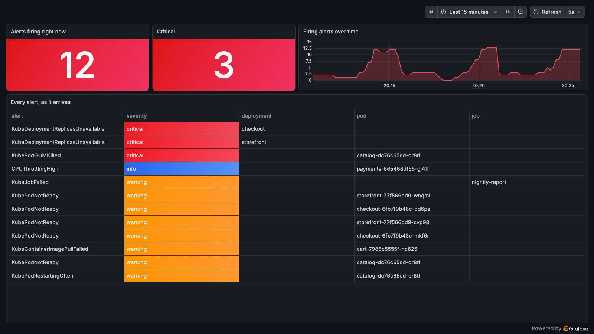
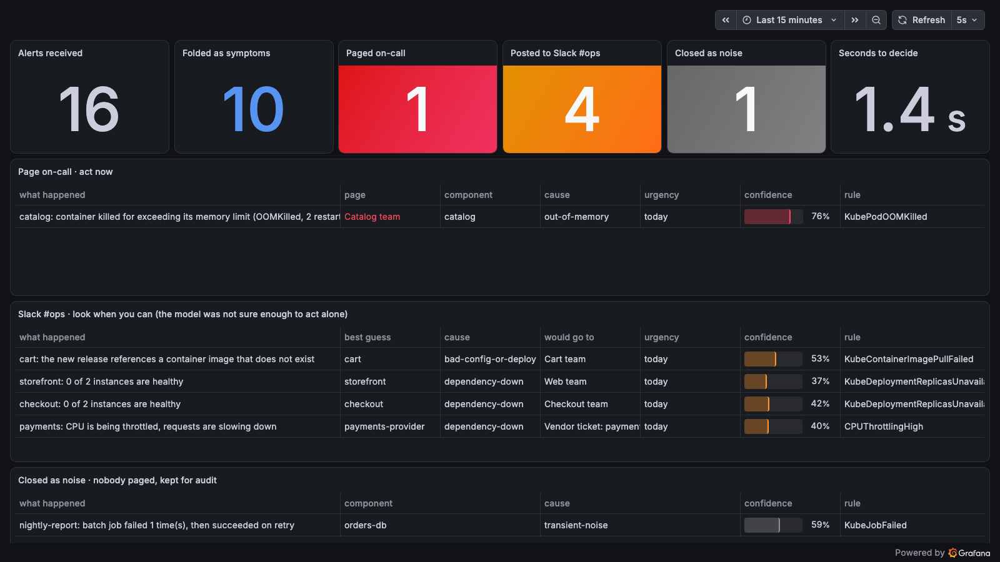

# Alert triage with a System One model

A small, reproducible demo of a **System One model** doing operations work. A fake shop runs in a
Kubernetes cluster with ordinary monitoring (Prometheus, Alertmanager, Grafana). You break it the
way production breaks. Every alert goes to a model that returns **typed decisions with
probabilities instead of text**, and the decisions sort the flood into three lanes:

| Lane | When | What happens |
|---|---|---|
| **Page on-call** | confident, actionable, serious | the owning team is paged, cause attached |
| **Slack #ops** | not confident enough to act alone | posted with the model's best guess, for a human to pick up |
| **Closed as noise** | confident nothing needs doing | closed, kept for audit, nobody paged |

Two Grafana dashboards show the same minute twice: **today** (every alert, a wall of red) and
**triaged** (three lanes, symptoms folded into their incident). The model is
[Laya](https://huggingface.co/convaiinnovations/laya), open weights, running on your own machine.
It speaks the same API as TypeSafe's Jev, so the code works against either.

```
 kind cluster                                                       your machine
 ┌────────────────────────────────────────────────────────────┐     ┌──────────────────┐
 │ shop: storefront → catalog, cart, checkout → orders-db,    │     │ laya-serve       │
 │       payments · nightly-report job                        │     │ (typed-decisions)│
 │        │ metrics                                            │     └────────▲─────────┘
 │        ▼                                                    │              │ POST /v1/systemone
 │ Prometheus ──rules──▶ Alertmanager ──webhook──▶ triage ─────┼──────────────┘
 │        │                                        service     │
 │        │ scrape                                   │ /metrics (lanes, counts)
 │        ▼                                          ▼         │
 │ Grafana: 01 · Alerts · today     02 · Alerts · triaged      │
 └────────────────────────────────────────────────────────────┘
       ▲ ./chaos.sh oom | bad-config | bad-image | cpu-spike | db-down | oops | flaky-job | storm
```

## What's in the repo

| Path | What it is |
|---|---|
| `demo.sh` | `up` / `open` / `status` / `down`: the whole environment in one command. |
| `chaos.sh` | Seven realistic incidents, a `storm` that fires five at once, `heal`. |
| `services/app.py` | The one microservice all six shop services run, with fault switches. |
| `k8s/shop.yaml`, `deploy.sh` | The shop. |
| `k8s/monitoring/rules.yaml` | Prometheus alert rules shaped like a real team's: one incident, several alerts. |
| `k8s/monitoring/dashboards.yaml` | The two Grafana dashboards. |
| `monitoring/values.yaml` | kube-prometheus-stack tuned for a demo (10 s scrape, 5 s grouping). |
| `triage_service.py`, `k8s/triage.yaml` | Alertmanager webhook → plain-language alert + logs → model → lanes → Prometheus metrics. Also serves its own board at `/board`. |
| `triage.py` | The CLI: `check`, `replay`, `watch`, `ask`, `log`. Shared decision logic. |
| `alerts.json`, `taxonomy.json`, `calibrate.py` | 30 labelled alerts for scoring, components → teams, temperature calibration. |
| `scripts/serve-laya.sh` | Runs Laya's `typed-decisions` checkpoint behind a Jev-compatible API. |

## Prerequisites

Python 3.10+, Docker (or Podman), `kubectl`, `helm`, and [kind](https://kind.sigs.k8s.io/) (one
binary). About 2 GB of disk for the model, 3 GB of RAM free for the cluster. No GPU needed; the
model answers in 1–4 s on a laptop CPU, in well under a second on a GPU.

## Run it

**Terminal 1: the model.** First run installs `laya[serve]` into `.venv` and downloads the
1.6 GB checkpoint into `.hf/`. Set `LAYA_PORT` if 8000 is taken on your machine.

```sh
git clone https://github.com/blacksoxx/system-one-aiops-demo && cd system-one-aiops-demo
./scripts/serve-laya.sh                       # add LAYA_DEVICE=cuda for an NVIDIA GPU
```

**Terminal 2: everything else.** `demo.sh up` creates a kind cluster with **its own kubeconfig
file** (`~/.kube/shop-kind.yaml`, so it never merges into clusters you already have), installs
Prometheus/Alertmanager/Grafana, deploys the shop, wires the model server on your machine into
the cluster, and starts the triage service, rules and dashboards. First run about five minutes,
mostly image pulls.

```sh
./demo.sh up                                  # LAYA_PORT=8600 ./demo.sh up if you changed the port
./demo.sh open                                # Grafana on :3000, the board on :8400, Alertmanager on :9093
```

Open **http://localhost:3000/d/alerts-today** and **http://localhost:3000/d/alerts-triaged**
(no login needed; admin password `triage` if you want to edit).

**Terminal 3: break things.**

```sh
export KUBECONFIG=~/.kube/shop-kind.yaml
./chaos.sh storm            # five incidents within a minute
./chaos.sh heal             # when you have seen enough
./demo.sh reset             # zero the triage counters and lanes before the next run
```

Monitoring takes 30–90 s to notice, like in real life. Then dashboard 01 fills with red, and
dashboard 02 shows the same alerts folded and sorted. `./chaos.sh` without arguments lists the
individual incidents; run them one at a time with `heal` in between to walk through each.

## Scoring and calibrating the model

```sh
python3 triage.py replay --model typed-decisions --no-calibration   # before
python3 calibrate.py --model typed-decisions                         # fit one temperature per question
python3 triage.py replay --model typed-decisions                     # after
```

`replay` sends 30 labelled alerts and prints accuracy, what happens as you move the threshold,
and whether the probabilities are honest (a reliability table with ECE). Measured on a laptop CPU
with Laya `typed-decisions` 0.4.17:

```
accuracy: component 87% · cause 57% · actionable 77%          (random: 12% · 11% · 50%)

before calibration:  said 0.3–0.5 → right 91% of the time · ECE 0.386 · nothing clears a 0.6 threshold
after calibration:   component T = 0.34 · ECE 0.139 in-sample, 0.198 two-fold · mean top-probability 0.48 → 0.80

threshold  auto-handled  accuracy when auto
  60%        10/30        70%
  70%         5/30       100%
  80%         2/30       100%
```

The model ranks the right component first 87% of the time but is **under-confident**: before
calibration it never crosses a usable threshold, so everything escalates. Temperature scaling
(one number per question, fitted on the labelled alerts) fixes the level without touching the
ranking, and the threshold becomes a real dial: raise it, and the automatic decisions get more
accurate while fewer are made. Accuracy itself does not change. The in-sample numbers above are
optimistic by construction; the live incidents are the out-of-sample check. `demo.sh up` ships
`calibration.json` into the cluster if it exists, so run `calibrate.py` first.

## What a live storm looked like

Laptop CPU, Laya `typed-decisions`, calibrated, threshold 0.6, `./chaos.sh storm`. About two
minutes after the command, the two dashboards showed the same minute like this:

| | |
|---|---|
|  |  |
| **Today:** 12 alerts firing, 3 critical, six rules, no order. | **Triaged:** 16 received, 10 folded as symptoms, 1 paged, 4 to Slack, 1 closed as noise, 1.4 s per decision. |

What the model decided, incident by incident:

```
catalog     out of memory            → PAGE   Catalog team · out-of-memory 98% · confidence 76%
cart        image tag does not exist → SLACK  best guess cart 80% · bad-config-or-deploy · 53%
orders-db   scaled to zero           → SLACK  "checkout: 0 of 2 instances healthy" · dependency-down · 42%
                                     → SLACK  "storefront: 0 of 2 healthy" (the cascade) · storefront 89% · 37%
payments    CPU throttled            → SLACK  payments-provider 68% · 40%
nightly job failed once, retry ok    → NOISE  transient-noise · confidence 59% · nobody paged
pod not ready, restarting often,
crash loop after the OOM kill        → folded into the incidents above (10 notifications)
```

Three things worth knowing. **One incident is several alerts**: five incidents produced
sixteen alert notifications, and ten of those were symptoms the service folded back into their incident. **Phrasing
matters**: when the crash-loop alert read like a Kubernetes rule ("Pod checkout-59fc… is crash
looping") the model said `cluster-platform` at 0.69; when it read like an engineer's note
("checkout: the application exits right after it starts… its last log lines are below") it said
`checkout` at 0.86, so the service writes alerts the second way. And **an uncertain model
escalating is the design working**: the storefront alert is a side effect of checkout being down,
and 37% confidence sent it to a human with a best guess instead of paging the web team.

## Using TypeSafe Jev instead

```sh
export TYPESAFE_API_KEY=...
python3 triage.py replay --base-url https://api.typesafe.ai/v1 --model jev-1.13
```

Same request and response shape, so every CLI command works unchanged. For the cluster, point the
`SYSTEMONE_BASE_URL` env in `k8s/triage.yaml` at the TypeSafe API and add the key as a Secret.

## Without the monitoring stack

`triage.py watch` scans a namespace directly (OOMKilled, CrashLoopBackOff, replicas unavailable,
job failed) and triages what it finds, so `./deploy.sh` + `./chaos.sh` + `watch` give you the same
decisions in a terminal with nothing else installed. `triage.py ask` triages any text you paste.
Every command accepts `--mock` for rehearsing without a model; mock answers say so in a banner.

## Honest notes

- The services are fake (`{"service": "cart", "ok": true}`). The OOM kills, crash loops, failed
  probes, image pull failures and job failures are real Kubernetes behaviour, and the alerts come
  from real Prometheus rules.
- Yes/no questions are asked as two-option **choices** rather than Laya's `noul` type, which was
  far weaker on this checkpoint (13% vs 77% on the same question).
- 30 hand-written alerts and one checkpoint version are enough to show the method, not to claim a
  benchmark. Measure on your own alerts before trusting any threshold.
- The model's output is a signal, never authorization. Text inside an alert, logs included, can
  steer the answer.

## Credits

Laya by Convai Innovations · TypeSafe docs for the System One API · kube-prometheus-stack ·
Guo et al., 2017, "On Calibration of Modern Neural Networks". MIT licensed.
